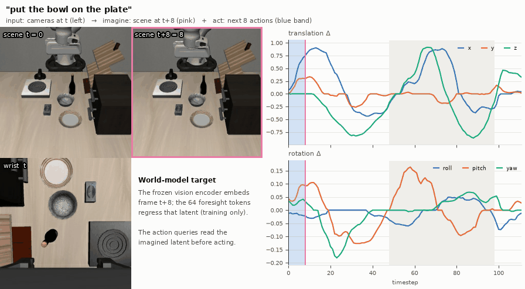
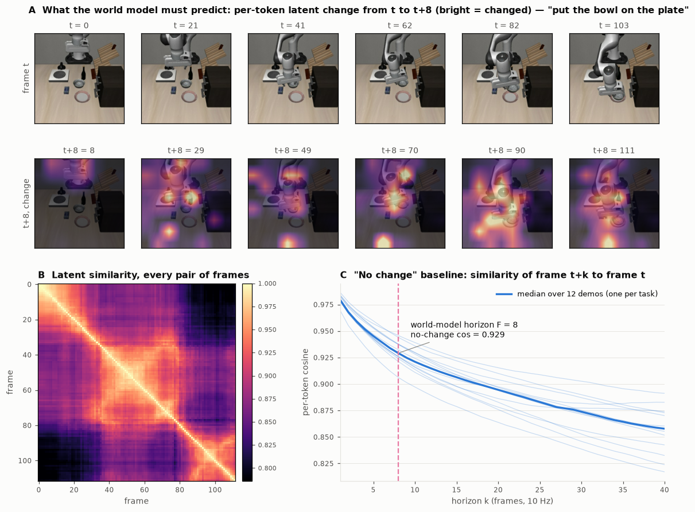

# wam-qwen

A compact **world action model (WAM)** built on **Qwen3-VL-2B-Instruct**, trained with LoRA on the same LIBERO data as
[`vla-qwen`](https://github.com/chengjianglong/vla-qwen). In a single forward pass it **imagines the future** (predicts the visual embedding of the
scene camera 8 frames ahead) **and acts** (predicts the next 8 robot actions), with the actions conditioned on the
imagined future.

<p align="center">
  
</p>

## Model

<p align="center">
  
</p>

```
[scene img][wrist img] Task: <instruction>  State: <s>  Future: <f_1 … f_64>  Actions: <a_1 … a_8>
                                   Qwen3-VL-2B + LoRA (causal)
hidden(f_k) ─ MLP ─▶ ẑ_k  ≈ LN( frozen Qwen3-VL vision embedding of scene frame t+8 )   MSE
hidden(a_i) ─ MLP ─▶ action_t+i (7-D, normalized to [-1, 1])                          L1
```

- **Foresight tokens:** 64 learned query tokens, one per merged vision token of a 224 px image (resized to 256 px → 8×8).
  Their hidden states are regressed onto the frozen vision encoder's post-merger output for the future scene frame, the
  same token space the LLM reads images in. So the model learns forward dynamics in its own visual latent space, and no
  pixel decoder is needed. Targets are layer-normalized per token (as in MAE's norm-pix loss).
- **Imagine → act:** the foresight tokens sit *before* the action queries, so with causal attention every action query
  can read the imagined future (the reverse is not possible). Inference needs no future image: the foresight tokens are
  always just learned queries.
- **Loss:** `L1(actions) + 0.5 · MSE(future latents)`.
- Everything else matches the VLA: placeholder tokens swapped for learned embeddings via an embedding-layer hook,
  8-D state token, LoRA r=32 on all LLM projections, frozen embedding table kept in CPU RAM, no vocab logits.
  Trainable: 49.7M parameters.

## Data

Read in place from `../vla-qwen/data/libero` (built by `../vla-qwen/prepare_data.py`). That is 1,693 episodes · 273k frames
· 40 tasks. Each sample is frame *t* (scene + wrist), the state, actions *t…t+7* and the scene frame *t+8* (clamped to the
episode end). The current and future scene frames share one random crop / color jitter, so the target stays
predictable. Every 50th episode (34 episodes, 5.3k frames) is held out for evaluation.

<p align="center">
  
</p>

## The latent space the world model predicts in



- **A:** the per-token change between frame *t* and *t+8* in the frozen encoder's 8×8 token grid. It concentrates on the
  arm, the gripper and the object being moved, with some weaker spots on static background. Predicting it is the
  world model's job.
- **B:** an episode moves through stretches where the latent barely changes (bright blocks), separated by sharp
  transitions.
- **C:** how well "no change" does as a guess: at the 8-frame horizon, frame *t* already has a per-token cosine of
  0.929 with frame *t+8* (median over 12 demos), and the score falls as the horizon grows. The world model has to beat
  that curve, not just score high.

## World-model metric

Neighbouring frames look alike, so a raw similarity score says little on its own. The training log and
`eval_offline.py` compare the prediction against the **"no change" baseline**: using frame *t*'s embedding as the guess
for frame *t+8*. The world model is only useful if `wm` < `copy` and `cos` > `cos copy`.

## Training

Training curves (action L1, and future-latent MSE against the no-change baseline) will go here once the first run
finishes: `python make_media.py --only curves --log runs_2k.log` writes `media/train_curves.png`.

## Files

| File | Purpose |
|---|---|
| `wam.py` | Model: Qwen3-VL + LoRA, foresight / action / state embeddings, world-model and action heads |
| `train.py` | Single- or multi-GPU (DDP) training; dataset with future-frame targets and held-out split |
| `make_media.py` | Renders the README figures in `media/` (vision latents computed on CPU, cached in `runs/`) |
| `eval_offline.py` | Action L1, gripper accuracy and world-model MSE/cosine vs. the no-change baseline on held-out episodes |

## Usage

Uses the `../vla-qwen/.env` environment (torch 2.11.0+cu128, transformers 5.23, peft 0.21).

```bash
PY=../vla-qwen/.env/bin
$PY/torchrun --nproc_per_node 2 train.py --steps 20 --log_every 5 --save_every 0 --out runs/smoke     # smoke test
$PY/torchrun --nproc_per_node 2 train.py --bs 1 --accum 8 --steps 2000 --warmup 100 --save_every 500 \
    --out runs/wam_2k 2>&1 | tee runs_2k.log
# one GPU (same 16 samples/step); expandable segments keep the peak at ~4.3 GB
CUDA_VISIBLE_DEVICES=1 PYTORCH_CUDA_ALLOC_CONF=expandable_segments:True $PY/python train.py --bs 1 --accum 16 \
    --steps 2000 --warmup 100 --save_every 250 --out runs/wam_2k 2>&1 | tee runs_2k.log
$PY/python eval_offline.py --ckpt runs/wam_2k/ckpt_002000.pt --n 500
```

`--future` sets the world-model horizon, `--wm_weight` the loss weight (0 turns the model back into the plain VLA with
extra query tokens, a useful ablation), and `--holdout_every 0` trains on all episodes.
