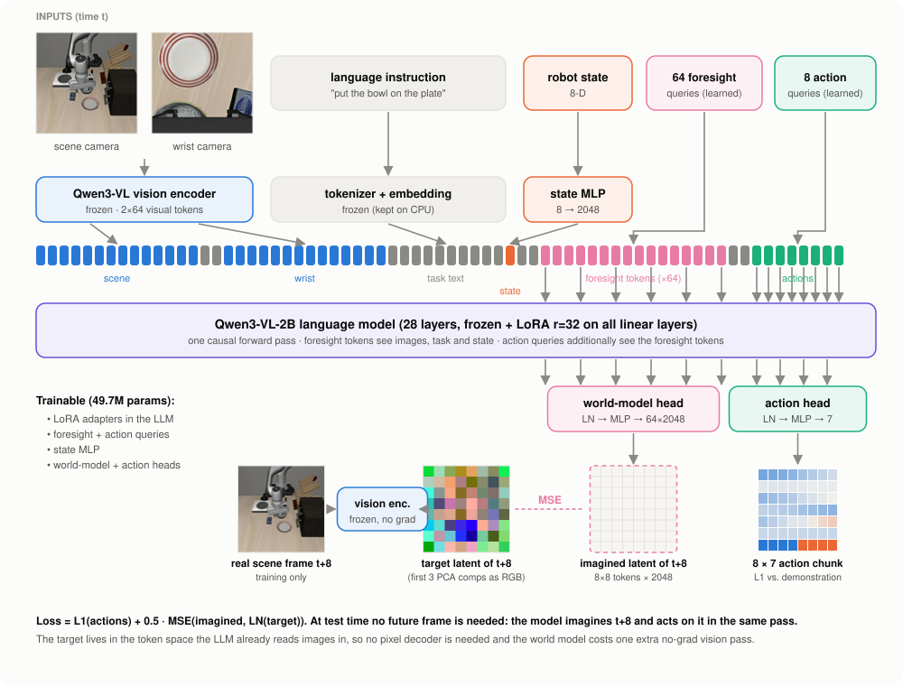
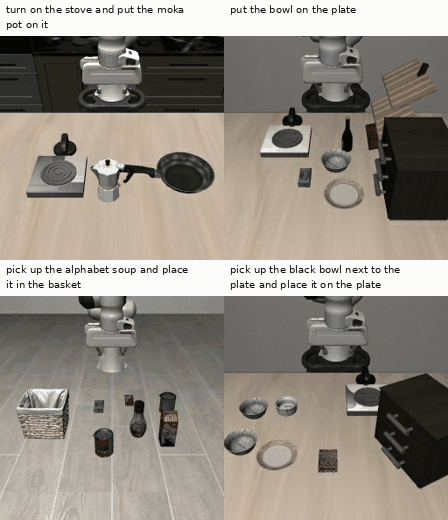
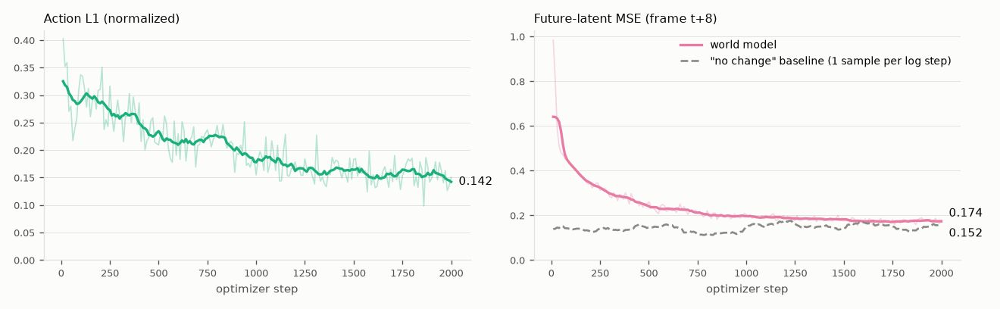

# wam-qwen

A compact **world action model (WAM)** built on **Qwen3-VL-2B-Instruct**, trained with LoRA on the same LIBERO data as
[`vla-qwen`](https://github.com/chengjianglong/vla-qwen). In a single forward pass it **imagines the future** (predicts the visual embedding of the
scene camera 8 frames ahead) **and acts** (predicts the next 8 robot actions), with the actions conditioned on the
imagined future.

<p align="center">
  
</p>

## Model

<p align="center">
  
</p>

```
[scene img][wrist img] Task: <instruction>  State: <s>  Future: <f_1 … f_64>  Actions: <a_1 … a_8>
                                   Qwen3-VL-2B + LoRA (causal)
hidden(f_k) ─ MLP ─▶ ẑ_k  ≈ LN( frozen Qwen3-VL vision embedding of scene frame t+8 )   MSE
hidden(a_i) ─ MLP ─▶ action_t+i (7-D, normalized to [-1, 1])                          L1
```

- **Foresight tokens:** 64 learned query tokens, one per merged vision token of a 224 px image (resized to 256 px → 8×8).
  Their hidden states are regressed onto the frozen vision encoder's post-merger output for the future scene frame, the
  same token space the LLM reads images in. So the model learns forward dynamics in its own visual latent space, and no
  pixel decoder is needed. Targets are layer-normalized per token (as in MAE's norm-pix loss).
- **Imagine → act:** the foresight tokens sit *before* the action queries, so with causal attention every action query
  can read the imagined future (the reverse is not possible). Inference needs no future image: the foresight tokens are
  always just learned queries.
- **Loss:** `L1(actions) + 0.5 · MSE(future latents)`.
- Everything else matches the VLA: placeholder tokens swapped for learned embeddings via an embedding-layer hook,
  8-D state token, LoRA r=32 on all LLM projections, frozen embedding table kept in CPU RAM, no vocab logits.
  Trainable: 49.7M parameters.

## Data

Read in place from `../vla-qwen/data/libero` (built by `../vla-qwen/prepare_data.py`). That is 1,693 episodes · 273k frames
· 40 tasks. Each sample is frame *t* (scene + wrist), the state, actions *t…t+7* and the scene frame *t+8* (clamped to the
episode end). The current and future scene frames share one random crop / color jitter, so the target stays
predictable. Every 50th episode (34 episodes, 5.3k frames) is held out for evaluation.

<p align="center">
  
</p>

## The latent space the world model predicts in


- **A:** the per-token change between frame *t* and *t+8* in the frozen encoder's 8×8 token grid. It concentrates on the
  arm, the gripper and the object being moved, with some weaker spots on static background. Predicting it is the
  world model's job.
- **B:** an episode moves through stretches where the latent barely changes (bright blocks), separated by sharp
  transitions.
- **C:** how well "no change" does as a guess: at the 8-frame horizon, frame *t* already has a per-token cosine of
  0.929 with frame *t+8* (median over 12 demos), and the score falls as the horizon grows. The world model has to beat
  that curve, not just score high.

## World-model metric

Neighbouring frames look alike, so a raw similarity score says little on its own. The training log and
`eval_offline.py` compare the prediction against the **"no change" baseline**: using frame *t*'s embedding as the guess
for frame *t+8*. The world model is only useful if `wm` < `copy` and `cos` > `cos copy`.

## Training

<p align="center">
  
</p>

2000 steps on one RTX A2000 (batch 1 × 16 accumulation = 16 samples per step, the same as the VLA run), AdamW,
lr 2e-4 with cosine decay, ~10.4 s/step, peak memory 4.31 GB, ~5.8 h in total.

**Held-out results** (`eval_offline.py` on random frames from the 34 held-out episodes; 200 frames at step 2k,
500 at step 20k):

| | WAM 2k | WAM 20k | "no change" baseline |
|---|---|---|---|
| action L1 (normalized, 8-step chunk) | 0.153 | **0.133** | |
| action L1, first step only | 0.151 | **0.134** | |
| gripper open/close accuracy | 95.1% | **95.9%** | |
| future-latent MSE (frame *t+8*) | 0.163 | **0.111** | 0.132 |
| future-latent cosine | 0.914 | **0.942** | 0.934 |

At 2k steps the world model was worse than guessing "nothing changes"; by 20k it beats that guess on held-out
episodes (MSE 16% lower), so it has started to predict how the scene moves, not just what it looks like.

**LIBERO simulator success** (`eval_libero.py`, the VLA's closed-loop protocol unchanged: 10 tasks per suite,
10 episodes per task, replan every 8 actions). Both 2k runs saw the same 16 samples per optimizer step:

| Model | Steps | Spatial | Object | Goal | Long | Average |
|---|---|---|---|---|---|---|
| [vla-qwen](https://github.com/chengjianglong/vla-qwen) VLA | 2,000 | 55% | **71%** | 45% | 10% | 45.2% |
| **wam-qwen WAM** | 2,000 | **77%** | 63% | **51%** | **20%** | **52.8%** |
| WAM without world-model loss (`--wm_weight 0`) | 2,000 | 50% | 60% | 38% | 14% | 40.5% |
| vla-qwen VLA (continued run) | 10,000 | **82%** | **97%** | 73% | 42% | 73.5% |
| **WAM (continued run)** | 10,000 | 75% | 89% | **82%** | **49%** | **73.8%** |
| vla-qwen VLA (continued run) | 20,000 | **98%** | 100% | **99%** | **87%** | **96.0%** |
| WAM (continued run) | 20,000 | 97% | 100% | 95% | 82% | 93.5% |

With 100 episodes per suite, one suite's rate is only accurate to about ±5 points, so read the per-suite gaps loosely.
Averages pool 400 episodes and are accurate to about ±2.5 points.

**The ablation isolates foresight.** The `--wm_weight 0` run is the same model, prompt, tokens, data and seed, with only
the world-model loss switched off. It drops from 52.8% to 40.5% (211 vs 162 of 400 episodes), below even the VLA.
Training the foresight tokens to predict the future frame is what makes the actions better; the extra tokens on
their own do not help, and may hurt slightly.

**By 10k steps the gap has closed.** All continued runs follow the same 20k cosine schedule, resumed from their 2k
runs. At 10k they tie (73.8% vs 73.5%); at 20k the VLA is slightly ahead (96.0% vs 93.5%, 384 vs 374 of 400 episodes),
a gap of about 1.6 standard errors, so not clearly real. The WAM also trained on 2% fewer episodes (34 held out).

**Takeaways:**

- Foresight helps early: at 2k steps the WAM succeeds more often than the VLA (52.8% vs 45.2%), and the
  `--wm_weight 0` ablation shows the world-model loss is the cause (40.5% without it).
- With longer training the advantage disappears: both models reach about the same success at 10k and 20k steps.
  On LIBERO, foresight speeds up learning rather than raising the level the policy reaches.
- The world model itself keeps improving: it beats the "nothing changes" guess on held-out episodes at 20k
  (latent MSE 0.111 vs 0.132), which it did not at 2k.
- LIBERO is close to saturated at 96%, which leaves little room to show a gain. Next experiments: predicting the
  *change* `z(t+8) − z(t)`; lower-data settings (e.g. 10% of the demonstrations), where faster learning should matter
  most; and harder or longer-horizon benchmarks.

## Files

| File | Purpose |
|---|---|
| `wam.py` | Model: Qwen3-VL + LoRA, foresight / action / state embeddings, world-model and action heads |
| `train.py` | Single- or multi-GPU (DDP) training; dataset with future-frame targets and held-out split |
| `make_media.py` | Renders the README figures in `media/` (vision latents computed on CPU, cached in `runs/`) |
| `eval_offline.py` | Action L1, gripper accuracy and world-model MSE/cosine vs. the no-change baseline on held-out episodes |
| `eval_libero.py` | Closed-loop LIBERO simulator eval; reuses `../vla-qwen/eval_libero.py` and swaps in the WAM policy |
| `run_eval.sh` | Runs `eval_libero.py` in `../vla-qwen/.env-libero` with headless EGL rendering (`GPU=<id>`) |

## Usage

Uses the `../vla-qwen/.env` environment (torch 2.11.0+cu128, transformers 5.23, peft 0.21).

```bash
PY=../vla-qwen/.env/bin
$PY/torchrun --nproc_per_node 2 train.py --steps 20 --log_every 5 --save_every 0 --out runs/smoke     # smoke test
$PY/torchrun --nproc_per_node 2 train.py --bs 1 --accum 8 --steps 2000 --warmup 100 --save_every 500 \
    --out runs/wam_2k 2>&1 | tee runs_2k.log
# one GPU (same 16 samples/step); expandable segments keep the peak at ~4.3 GB
CUDA_VISIBLE_DEVICES=1 PYTORCH_CUDA_ALLOC_CONF=expandable_segments:True $PY/python train.py --bs 1 --accum 16 \
    --steps 2000 --warmup 100 --save_every 250 --out runs/wam_2k 2>&1 | tee runs_2k.log
$PY/python eval_offline.py --ckpt runs/wam_2k/ckpt_002000.pt --n 500
GPU=0 ./run_eval.sh --ckpt runs/wam_2k/ckpt_002000.pt --trials 10 2>&1 | tee eval_wam_2k.log   # simulator, ~1.75 h
```

`--future` sets the world-model horizon, `--wm_weight` the loss weight (0 turns the model back into the plain VLA with
extra query tokens, a useful ablation), and `--holdout_every 0` trains on all episodes.
